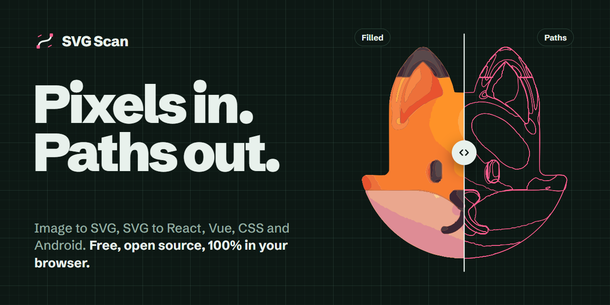
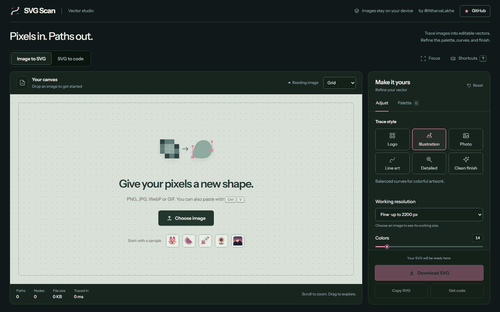

<div align="center">

<a href="https://atharvalakhe.github.io/SVG_Scan/"></a>

# SVG Scan

**Trace images into editable SVG paths, then convert SVG into React, Vue, CSS or Android code.**<br>
Runs entirely in your browser. No uploads, no sign-up, no runtime dependencies.

### [Open SVG Scan &rarr;](https://atharvalakhe.github.io/SVG_Scan/)

[](https://github.com/AtharvaLakhe/SVG_Scan/stargazers)
[](LICENSE)
[](#use-the-engine-in-your-own-project)
[](#run-it-locally)

</div>

<p align="center"><a href="https://atharvalakhe.github.io/SVG_Scan/"></a></p>

<p align="center"><sub>A complex poster with gradient shading, fine orbital lines, typography, and botanical layers, traced in the current studio. The loop shows tracing, comparison, zoom, outlines, and palette controls.</sub></p>

## Why

SVG Scan processes images on your machine, with progress and cancellation through a Web Worker. You control the palette, retained detail, and finish; the export contains editable SVG paths and supported gradients.

## Get started

1. [Open SVG Scan](https://atharvalakhe.github.io/SVG_Scan/) and drop, paste, or choose an image. Try a built-in sample if you want to explore first.
2. Let the automatic settings trace it. **Fine** resolution is selected initially; small images stay at their native size.
3. Switch between **Compare**, **Vector**, and **Outline**. Use **1:1** to inspect detail at the source pixel scale, or **Fit** to see the whole image.
4. Refine the preset, palette, and curves. Wait for **Vector ready**, then download or copy the SVG. Choose **Get code** for component and platform formats.

**Reset** restores the image's automatic recommendation. Processing stays on your device, including when using the hosted app.

## Choose your finish

| Setting | Use it for | Tradeoff |
| --- | --- | --- |
| **Automatic** | A first trace that retains source detail | Exact palettes of up to 128 visible RGB colors keep small marks without cleanup; richer images generally start with Detailed |
| **Detailed** | Shaded grayscale, detailed artwork, and photo texture | Retains grain and small features; can create large files |
| **Clean finish** | Softer shading and more rounded contours at high zoom | Reduces grain and simplifies some texture |
| **Photo** | A more compact photographic interpretation | Uses fewer colors and stronger cleanup, so fine detail is reduced |
| **Illustration** | Colorful artwork with smoother shapes | Simplifies the palette and small regions |
| **Logo** | Flat graphics and simple marks | The manual preset uses six colors and cleanup; automatic exact-palette settings can differ |
| **Line art** | Deliberately two-color drawings | Removes shaded tones; use Detailed for shaded grayscale artwork |

If details disappear, try **Detailed** with **Fine** resolution before increasing colors. If the result looks grainy or meshy when enlarged, try **Clean finish**, then adjust Smoothness and edge-aware denoising. Outline shows the path geometry rather than the finished fills; use Vector to judge the exported appearance.

Fine detail and a smooth finish involve different compromises. The tracer follows information present in the source; it does not redraw objects or recover missing detail. For smaller files, reduce resolution or colors, or try Photo. More colors alone do not guarantee a better result.

## What it does

### Image to SVG

- **Drop, paste or pick** any PNG, JPG, WebP or GIF. <kbd>Ctrl</kbd> <kbd>V</kbd> works from anywhere on the page.
- **Presets** for logos, illustrations, compact photos, line art, detailed images, and a Clean finish. Automatic settings preserve exact small palettes and recommend 64 or 96 tones for richer artwork, with no structural cleanup. Choose Clean finish for softer shading and less grain at high zoom.
- **Live controls** for up to 128 colors, detail, smoothness, noise and edge-aware denoising. Fast, Balanced and Fine resolutions work up to 900, 1400 and 2200 px, within a four-million-pixel ceiling. Fine is the initial choice; small sources stay at their original size. Every change re-traces off the main thread.
- **Canvas-first workspace** with a pale drafting surface, compact forest chrome, illustrated trace presets, Adjust and Palette tabs, and anchored desktop exports. The introduction steps aside after loading an image. Focus mode expands the editor; Fit, actual-size zoom and a miniature navigator make enlarged images easier to explore. Advanced cleanup and technical explanations stay out of the way until needed.
- **Current-result exports** wait for settings changes to finish tracing, including during slider debounce and code-mode switching. Cancelling a retrace restores access to the last completed vector.
- **Transparency** stays translucent through a vector luminance mask applied once to the composed layers. No embedded bitmap.
- **Cancel and replace** long traces; results from old images and settings are discarded.
- **Smooth gradients**: qualifying shading uses real `<linearGradient>` and `<radialGradient>` fills, including focal points for lit shapes. Complex textures and shading can still retain quantized bands. Toggle it to see the difference.
- **Compare, Vector and Outline views**, with a drag-to-compare slider, Fit and actual-size zoom, panning, and a miniature navigator.
- **Drop a color** from the Palette tab to leave that layer out of the export, then restore all colors in one click. With stacked layers, removing a foreground color reveals the layers underneath.
- **Real stats**: path count, node count, file size, trace time.

### SVG to code

Paste or open any SVG and get it back in seven shapes:

| Format | What you get |
| --- | --- |
| **React** | A typed `.tsx` (or `.jsx`) component with camelCased props and `{...props}` spread |
| **React Native** | A `react-native-svg` component with the right imports, CSS styles inlined as props |
| **Vue** | A single-file component template |
| **Clean SVG** | Editor cruft removed, numbers rounded, path data rewritten in its shortest form |
| **CSS** | A class with the SVG as a URL-encoded background, or as a `mask` when using `currentColor` |
| **Data URI** | A ready-to-paste `` with a base64 source |
| **Android** | A `VectorDrawable` XML, with shapes converted to paths, transforms mapped to groups and linear and radial gradients kept |

Toggle **TypeScript**, switch every color to **`currentColor`** for icon sets, or pick how many **decimals** to keep. Cleanup savings depend on the input SVG.

## How the tracer works

The engine lives in [`tracer.js`](tracer.js), with no runtime dependencies. Shared app presets and resolution limits live in [`trace-settings.js`](trace-settings.js).

1. **Quantize.** k-means++ picks a palette in the [OKLab](https://bottosson.github.io/posts/oklab/) color space, so clusters spread evenly over what the eye can tell apart, then every pixel snaps to its nearest color. Flat images with few colors skip clustering and keep their exact colors.
2. **Clean.** Anti-aliased edges leave thin bands of in-between color (orange next to black makes a brown outline). A pixel at most 3 px thick whose color sits between its two neighbours' colors folds back into the closer one; real thin lines survive because they aren't blends. A 3×3 majority filter smooths dithered band edges and specks below the noise threshold merge into their neighbour.
3. **Merge.** Quantizing smooth shading slices it into bands, and the borders between those bands are *soft*: the source image barely changes across them, while real edges are sharp. Regions are merged across soft borders, softest first, but only when the union is still described by one gradient about as well as its parts were. A banded sky or a lit ball collapses back into one shape.
4. **Trace.** Each color is walked along its pixel edges into closed loops, clockwise around shapes and counter-clockwise around holes, so the default fill rule renders holes correctly. The largest layer covers the whole silhouette and every other layer reaches a few pixels under the layers drawn above it, so each edge is drawn over its real neighbour and anti-aliasing never lets an unrelated color bleed through as a seam.
5. **Fit curves.** Loops are built from edge *midpoints*, which turns pixel staircases into clean diagonals. A corner is a point where the turn is sharp across ±k pixels *and* most of it survives at ±k/2 (a tight curve loses half its turn, a real corner keeps it); each corner is snapped to where its two edges intersect. Between corners the outline is lightly smoothed, then fit with least-squares cubic Béziers using Schneider's algorithm with Newton–Raphson reparameterization.
6. **Fit gradients.** Each region's shading is modelled three ways: flat, *linear* (a color profile along the direction a least-squares plane says the color changes fastest) and *radial* (a profile by distance from the peak of a least-squares bowl `c = a + bu + cv + d(u² + v²)`). Profiles are free-form, 16 buckets thinned to the fewest stops that reproduce them, so a four-color sky fits as well as a two-color ramp. Lit 3D shapes have off-center highlights whose rings shift as they grow, so radial winners get a Nelder–Mead search for SVG's focal point (`fx`, `fy`). The best model becomes a `<linearGradient>` or `<radialGradient>`.

Path data is written with relative commands computed between already-rounded points (so rounding never drifts), implicit command repetition, and the fewest separators the SVG grammar allows.

### Measured quality

The repeatable accuracy suite compares revision `f9e375d` with the updated application defaults: previous automatic Balanced settings versus current automatic Fine settings, using identical images and rendering actual exports at the **original source dimensions**. It measures RGB RMSE on white and black, alpha RMSE and bias, edge error, output bytes, nodes, and time. Lower RMS is better. This comparison includes preparation, recommendation, fitting, transparency, and export fixes; it does not isolate a single algorithm change.

The tracked report contains 21 reproducible cases, including six photographs, vector-style art, fine ink, pixel art, soft transparency, different shading directions, and a 2400 × 1600 tiled photographic stress case. An additional local run used the user's original grayscale image. Full numbers are in [`tests/benchmark/accuracy-results.json`](tests/benchmark/accuracy-results.json); fixture provenance is in [`tests/fixtures/README.md`](tests/fixtures/README.md). Results depend on the browser and available fonts for generated text/emoji; timings also depend on hardware and concurrent work.

| Source | Previous export RGB RMSE | Updated export RGB RMSE |
| --- | --- | --- |
| Logo and text | 11.58 | **5.60** |
| Line art | 11.52 | **5.78** |
| Astronaut portrait | 7.18 | **6.73** |
| Coffee photograph | 7.46 | **6.09** |
| Dog photograph | 4.64 | **4.15** |
| Different shading directions | 9.04 | **2.25** |
| Pixel art with one-pixel accents | 12.27 | **0.16** |
| Translucent photograph | 3.94 | **1.42** |
| Large photographic texture | 12.08 | **9.29** |

Soft-glow alpha RMS fell from 6.53 to 3.65, and transparent-curve alpha RMS from 7.09 to 3.42. Partial opacity is rounded to the nearest band rather than consistently increased. Exports also preserve their intended dimensions when integer working sizes slightly change aspect ratio.

Automatic recommendations preserve exact palettes of at most 128 visible RGB colors without smoothing, blur, or structural cleanup. Rich small images start with 96 tones; larger detailed images use 64 to limit geometry growth. Verified simple ramps retain compact gradient output. Manual presets and controls remain available.

Detailed prioritizes fidelity. Fine retains source pixels up to its limit and never enlarges small images. Large textures can produce **tens of megabytes**: the 2400 × 1600 stress case generated a 27.6 MB SVG with 2.4 million nodes. Lower resolution, fewer colors, or the compact Photo preset reduce that cost. More colors do not guarantee a better fit for every image.

Clean finish keeps 64 tones and uses stronger edge-aware denoising with rounded small contours. Its 7×7 filter suppresses low-contrast grain while retaining contrasting lines; cleaned tones drive geometry and paint. It exports ordinary paths without embedded images or blur filters. Cleaning simplifies some texture and cannot reconstruct information absent from the source.

The earlier historical comparison with `b36b29a` remains in [`tests/benchmark/results.json`](tests/benchmark/results.json).

## Use the engine in your own project

`tracer.js` works in the browser, in a Web Worker, and in Node.

```html
<script src="tracer.js"></script>
<script>
  const ctx = canvas.getContext('2d');
  const image = ctx.getImageData(0, 0, canvas.width, canvas.height);

  const result = SVGScan.trace(image, { colors: 8, tolerance: 1, smoothness: 1 });
  const svg = SVGScan.toSVG(result);
</script>
```

```js
// Node: this example uses sharp, installed separately as an image decoder.
// Any decoder that gives you RGBA pixels works.
const sharp = require('sharp');
const { trace, toSVG } = require('./tracer.js');

async function main() {
  const { data, info } = await sharp('logo.png').ensureAlpha().raw().toBuffer({ resolveWithObject: true });
  const svg = toSVG(trace({ width: info.width, height: info.height, data }, { colors: 6 }));
  console.log(svg);
}

main().catch(console.error);
```

| Option | Default | What it does |
| --- | --- | --- |
| `colors` | `8` | Palette size (2 to 256 in the engine; up to 128 in the UI) |
| `tolerance` | `1` | Max distance, in pixels, a fitted curve may stray from the traced edge |
| `smoothness` | `1` | `0` gives polygons; higher values smooth pixel noise harder before fitting |
| `corner` | `60` | Turns sharper than this many degrees stay corners |
| `noise` | `8` | Regions with fewer pixels than this get absorbed |
| `majority` | `0` | Passes of the 3×3 majority filter |
| `dehalo` | `true` | Fold anti-aliasing halos back into the colors they blend |
| `gradients` | `true` | Give shaded regions a linear or radial gradient instead of a flat fill |
| `merge` | `6` | Merge regions across soft borders while one gradient still fits within this RMS error (0–255) |
| `blur` | `0` | Box blur radius (0–8), using premultiplied colors while retaining original opacity |
| `denoise` | `0` | Edge-aware smoothing strength (0–100); contrasting fine edges survive |
| `precision` | `1` | Decimals in the path data |

`trace()` accepts an unsigned RGBA byte array (`Uint8Array`, `Uint8ClampedArray`, or Node `Buffer`) with integer dimensions and at most 4,000,000 pixels. Invalid inputs and nonfinite numeric options throw descriptive errors. Numeric options are bounded before processing. Tiny components are retained when noise filtering is disabled.

`result.alpha` contains vector opacity-mask paths; `result.stats.alphaNodes` counts their nodes. `toSVG(result, { idPrefix: 'my-icon-' })` lets you avoid definition ID collisions when embedding several generated SVGs in one document. Opacity uses exact levels when there are at most 16 and quantizes richer alpha to at most 16 bands using nearest-level rounding. Set `preserveAspectRatio: 'none'` in `toSVG` options when explicit output dimensions must stretch the working viewBox exactly, as the app does to avoid rounding-related letterboxing. Highly textured transparency is rejected once its mask boundaries exceed 500,000 edges, before contour allocation; lower the resolution or flatten that image first.

Grayscale alone does not imply line art. Automatic analysis considers every visible alpha level and preserves bounded exact palettes, including rare accents. Rich shaded grayscale artwork uses Detailed. The manual Line art preset intentionally reduces the image to two colors.

### Limits

- Tracing reconstructs visible shapes and colors, not the original editable scene, objects, text, or font. Fine photo textures need many vector nodes.
- Gradients still fit one shading model per palette layer; disconnected objects sharing that palette entry can have different shading that one model cannot capture.
- Opacity masks work in SVG, React, React Native and Vue output. Android VectorDrawable cannot represent these masks; conversion reports this instead of silently exporting an opaque image.
- File decoding uses the browser's image support. If Web Workers are unavailable, tracing falls back to the main thread; the interface can pause during that synchronous fallback.

## Run it locally

There is no build step. Any static server works (Web Workers need `http://`, not `file://`).

```bash
git clone https://github.com/AtharvaLakhe/SVG_Scan.git
cd SVG_Scan
npx serve .        # or: python -m http.server
```

## Keyboard shortcuts

| Key | Action |
| --- | --- |
| <kbd>Ctrl</kbd> <kbd>V</kbd> | Paste an image to trace, or SVG markup to convert |
| <kbd>1</kbd> <kbd>2</kbd> <kbd>3</kbd> | Compare, Vector, Outline view |
| <kbd>+</kbd> <kbd>-</kbd> <kbd>0</kbd> | Zoom in, zoom out, fit |
| <kbd>?</kbd> | Open keyboard shortcuts |
| Double-click | Zoom in at that point, or back to fit |
| <kbd>Esc</kbd> | Close keyboard help, or leave Focus mode |

## Development checks

The app still has no build step or runtime packages. Automated checks require Node 20+ and development-only Playwright:

```bash
npm ci
npx playwright install chromium
npm test
npm run test:browser
```

Run `npm run bench:accuracy` while serving the repository to reproduce the pinned source-dimension comparison (Git must be available for the baseline). Set `SVG_SCAN_REPORT_DIR` to save full and 300% comparison images; `SVG_SCAN_GIT` can point to a Git executable outside PATH.

The suite covers engine and settings behavior plus real-browser workers, cancellation, replacement, fallback, opacity and hole rendering, exact small palettes, photographic fidelity, export sizing, code conversion, mobile layout, and keyboard operation. Browser tests start a local static server automatically, or reuse a server on port 8765.

### Reproduce the image comparison

After installing the development dependencies and Chromium above, start the included server in one terminal:

```bash
node tests/server.js
```

In another terminal, from the repository root:

```bash
npm run bench:accuracy
```

This writes the 21-case public report to `tests/benchmark/accuracy-results.json`. Keep the pinned baseline revision in your Git history; a shallow clone may need more history before the comparison can run. A full clone from the local setup instructions includes it.

To also save the before/after gallery and 300% crops, set an output directory. For example, in PowerShell:

```powershell
$env:SVG_SCAN_REPORT_DIR = Join-Path $env:TEMP 'svg-scan-accuracy'
npm run bench:accuracy
```

Use `SVG_SCAN_ORIGIN` for a server address other than `http://127.0.0.1:8765`. The benchmark compares actual exports at source dimensions against revision `f9e375d`; it measures the complete automatic workflow rather than an isolated engine change. Review the images as well as the numbers: lower pixel error does not describe every visual preference.

### Historical benchmark

For the visual benchmark, serve the repo and open `tests/benchmark/bench.html`, then run `runBench()` in its console, or run `node tests/benchmark/measure.js`. Use `runBench(['dog', 'mountain'], {preset: 'detailed'})` to compare quality. To reproduce the previous revision too, save `git show b36b29a:tracer.js` to `.playwright-mcp/baseline-tracer.js` before running the measurement script.

## Roadmap

- [ ] CLI: `npx svg-scan logo.png > logo.svg`
- [ ] Publish the engine to npm
- [x] Gradient detection, so smooth fills become `<linearGradient>` instead of bands
- [x] Radial gradients with focal points for round, lit shapes
- [ ] Centerline tracing for line art and handwriting
- [ ] Flutter and SwiftUI output
- [ ] Batch mode: drop a folder, get a zip

Want one of these? Open an issue or send a PR. Small, focused PRs get merged fastest.

## Contributing

1. Fork and clone the repo.
2. Serve the folder and open it in your browser.
3. Make your change, try it on a logo, an emoji and a photo.
4. Open a pull request with a before and after screenshot.

Bug reports with the image that broke the tracer are gold.

## Support the project

If SVG Scan saved you a trip to a paywalled converter, **[give it a star](https://github.com/AtharvaLakhe/SVG_Scan)**. It's the main way other people find it. To see what I build next, [follow me on GitHub](https://github.com/AtharvaLakhe).

## License

[MIT](LICENSE) © Atharva Lakhe
