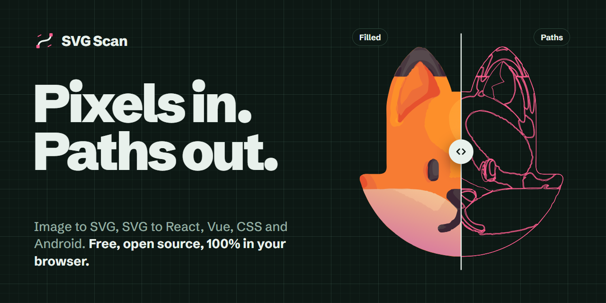
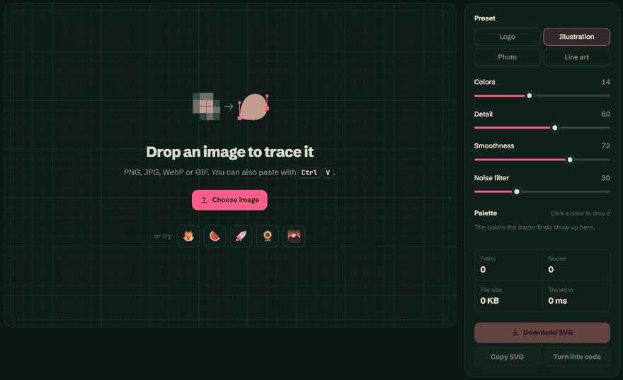

<div align="center">

<a href="https://atharvalakhe.github.io/SVG_Scan/"></a>

# SVG Scan

**Turn any image into a clean SVG, then turn that SVG into React, Vue, CSS or Android code.**<br>
Runs entirely in your browser. No uploads, no sign-up, zero dependencies.

### [Open SVG Scan &rarr;](https://atharvalakhe.github.io/SVG_Scan/)

[](https://github.com/AtharvaLakhe/SVG_Scan/stargazers)
[](LICENSE)
[](#use-the-engine-in-your-own-project)
[](#run-it-locally)

</div>

<p align="center"></p>

## Why

Most "PNG to SVG" sites upload your image to a server, wrap the result in a paywall, or hand back a single path stuffed with thousands of jagged nodes. SVG Scan does the whole job on your machine, in a Web Worker, in a couple hundred milliseconds, and the output is something you'd actually commit.

## What it does

### Image to SVG

- **Drop, paste or pick** any PNG, JPG, WebP or GIF. <kbd>Ctrl</kbd> <kbd>V</kbd> works from anywhere on the page.
- **Presets** for logos, illustrations, photos and line art, auto-picked from the image's colors.
- **Live sliders** for colors, detail, smoothness and noise. Every change re-traces off the main thread.
- **Smooth gradients**: shaded areas come out as real `<linearGradient>` fills instead of stepped bands. Toggle it to see the difference.
- **Compare, Vector and Outline views**, with a drag-to-compare slider and zoom up to 3200%. The original pixelates, the vector stays sharp.
- **Drop a color** from the palette to delete it from the export. Click the background swatch and you've removed the background.
- **Real stats**: path count, node count, file size, trace time.

### SVG to code

Paste or open any SVG and get it back in seven shapes:

| Format | What you get |
| --- | --- |
| **React** | A typed `.tsx` (or `.jsx`) component with camelCased props and `{...props}` spread |
| **React Native** | A `react-native-svg` component with the right imports, CSS styles inlined as props |
| **Vue** | A single-file component template |
| **Clean SVG** | Editor cruft removed, numbers rounded, path data rewritten in its shortest form |
| **CSS** | A class with the SVG as a URL-encoded background, or as a `mask` when using `currentColor` |
| **Data URI** | A ready-to-paste `` with a base64 source |
| **Android** | A `VectorDrawable` XML, with shapes converted to paths, transforms mapped to groups and linear gradients kept |

Toggle **TypeScript**, switch every color to **`currentColor`** for icon sets, or pick how many **decimals** to keep. An Inkscape export typically comes out 50 to 70% smaller.

## How the tracer works

All of it lives in [`tracer.js`](tracer.js), about 800 lines with no dependencies.

1. **Quantize.** k-means++ picks a palette in the [OKLab](https://bottosson.github.io/posts/oklab/) color space, so clusters spread evenly over what the eye can tell apart, then every pixel snaps to its nearest color. Flat images with few colors skip clustering and keep their exact colors.
2. **Clean.** Anti-aliased edges leave thin bands of in-between color (orange next to black makes a brown outline). A pixel at most 3 px thick whose color sits between its two neighbours' colors folds back into the closer one; real thin lines survive because they aren't blends. A 3×3 majority filter smooths dithered band edges, specks below the noise threshold merge into their neighbour, and touching regions that together fit one linear color ramp are merged, so a banded sky collapses back into one shape.
3. **Trace.** Each color is walked along its pixel edges into closed loops, clockwise around shapes and counter-clockwise around holes, so the default fill rule renders holes correctly. The largest layer covers the whole silhouette and every other layer reaches a few pixels under the layers drawn above it, so each edge is drawn over its real neighbour and anti-aliasing never lets an unrelated color bleed through as a seam.
4. **Fit.** Loops are built from edge *midpoints*, which turns pixel staircases into clean diagonals. A corner is a point where the turn is sharp across ±k pixels *and* most of it survives at ±k/2 (a tight curve loses half its turn, a real corner keeps it); each corner is snapped to where its two edges intersect. Between corners the outline is lightly smoothed, then fit with least-squares cubic Béziers using Schneider's algorithm with Newton–Raphson reparameterization. Finally each region's color is fit as a linear ramp by least squares, and regions where the ramp explains the shading get a `<linearGradient>`.

Path data is written with relative commands computed between already-rounded points (so rounding never drifts), implicit command repetition, and the fewest separators the SVG grammar allows.

### Benchmarks

Default presets, traced at the app's working resolution, compared with the first release of the engine:

| Image | First release | Now | Error (RMSE, lower is better) |
| --- | --- | --- | --- |
| Fox emoji | 120 KB, 6,111 nodes | **29 KB**, 1,273 nodes | 7.05 → **6.34** |
| Watermelon emoji | 50 KB, 2,372 nodes | **8 KB**, 299 nodes | 6.66 → **5.34** |
| Flat logo with text | 16 KB, 972 nodes | **2.5 KB**, 113 nodes | 10.30 → **7.66** |
| Line art | 14 KB, 794 nodes | **3.7 KB**, 150 nodes | 7.66 → **7.38** |
| Landscape photo | 765 KB, 43,207 nodes | **130 KB**, 6,946 nodes | 16.50 → **14.29** |

## Use the engine in your own project

`tracer.js` works in the browser, in a Web Worker, and in Node.

```html
<script src="tracer.js"></script>
<script>
  const ctx = canvas.getContext('2d');
  const image = ctx.getImageData(0, 0, canvas.width, canvas.height);

  const result = SVGScan.trace(image, { colors: 8, tolerance: 1, smoothness: 1 });
  const svg = SVGScan.toSVG(result);
</script>
```

```js
// Node: any decoder that gives you RGBA pixels works
const { trace, toSVG } = require('./tracer.js');
const { data, info } = await sharp('logo.png').ensureAlpha().raw().toBuffer({ resolveWithObject: true });
const svg = toSVG(trace({ width: info.width, height: info.height, data }, { colors: 6 }));
```

| Option | Default | What it does |
| --- | --- | --- |
| `colors` | `8` | Palette size (2 to 64) |
| `tolerance` | `1` | Max distance, in pixels, a fitted curve may stray from the traced edge |
| `smoothness` | `1` | `0` gives polygons; higher values smooth pixel noise harder before fitting |
| `corner` | `60` | Turns sharper than this many degrees stay corners |
| `noise` | `8` | Regions with fewer pixels than this get absorbed |
| `majority` | `0` | Passes of the 3×3 majority filter |
| `dehalo` | `true` | Fold anti-aliasing halos back into the colors they blend |
| `gradients` | `true` | Give shaded regions a linear gradient instead of a flat fill |
| `merge` | `6` | Merge touching regions that together fit one gradient within this RMS error (0–255) |
| `blur` | `0` | Box blur radius applied before quantizing |
| `precision` | `1` | Decimals in the path data |

## Run it locally

There is no build step. Any static server works (Web Workers need `http://`, not `file://`).

```bash
git clone https://github.com/AtharvaLakhe/SVG_Scan.git
cd SVG_Scan
npx serve .        # or: python -m http.server
```

## Keyboard shortcuts

| Key | Action |
| --- | --- |
| <kbd>Ctrl</kbd> <kbd>V</kbd> | Paste an image to trace, or SVG markup to convert |
| <kbd>1</kbd> <kbd>2</kbd> <kbd>3</kbd> | Compare, Vector, Outline view |
| <kbd>+</kbd> <kbd>-</kbd> <kbd>0</kbd> | Zoom in, zoom out, fit |
| Double-click | Zoom to 400% at that point, or back to fit |

## Roadmap

- [ ] CLI: `npx svg-scan logo.png > logo.svg`
- [ ] Publish the engine to npm
- [x] Gradient detection, so smooth fills become `<linearGradient>` instead of bands
- [ ] Radial gradients for round, lit shapes
- [ ] Centerline tracing for line art and handwriting
- [ ] Flutter and SwiftUI output
- [ ] Batch mode: drop a folder, get a zip

Want one of these? Open an issue or send a PR. Small, focused PRs get merged fastest.

## Contributing

1. Fork and clone the repo.
2. Serve the folder and open it in your browser.
3. Make your change, try it on a logo, an emoji and a photo.
4. Open a pull request with a before and after screenshot.

Bug reports with the image that broke the tracer are gold.

## Support the project

If SVG Scan saved you a trip to a paywalled converter, **[give it a star](https://github.com/AtharvaLakhe/SVG_Scan)**. It's the main way other people find it. To see what I build next, [follow me on GitHub](https://github.com/AtharvaLakhe).

## License

[MIT](LICENSE) © Atharva Lakhe
