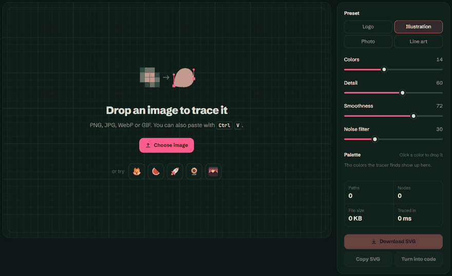

<div align="center">

<a href="https://atharvalakhe.github.io/SVG_Scan/"></a>

# SVG Scan

**Turn any image into a clean SVG, then turn that SVG into React, Vue, CSS or Android code.**<br>
Runs entirely in your browser. No uploads, no sign-up, zero dependencies.

### [Open SVG Scan &rarr;](https://atharvalakhe.github.io/SVG_Scan/)

[](https://github.com/AtharvaLakhe/SVG_Scan/stargazers)
[](LICENSE)
[](#use-the-engine-in-your-own-project)
[](#run-it-locally)

</div>

<p align="center"></p>

## Why

Most "PNG to SVG" sites upload your image to a server, wrap the result in a paywall, or hand back a single path stuffed with thousands of jagged nodes. SVG Scan does the whole job on your machine, in a Web Worker, in a couple hundred milliseconds, and the output is something you'd actually commit.

## What it does

### Image to SVG

- **Drop, paste or pick** any PNG, JPG, WebP or GIF. <kbd>Ctrl</kbd> <kbd>V</kbd> works from anywhere on the page.
- **Presets** for logos, illustrations, compact photos, line art, detailed images, and a Clean finish. Complex and shaded grayscale images automatically use Detailed: 64 colors, fine curves, and no structural cleanup. Choose Clean finish for softer shading and less grain at high zoom.
- **Live controls** for up to 128 colors, detail, smoothness, noise and edge-aware denoising. Fast, Balanced and Fine resolutions work up to 900, 1400 and 2200 px, within a four-million-pixel ceiling. Every change re-traces off the main thread.
- **Focused workspace** with an image header, canvas background choices, Adjust and Palette tabs, an always-visible desktop export area, and a keyboard shortcuts dialog. Advanced cleanup stays out of the way until needed.
- **Transparency** stays translucent through a vector luminance mask applied once to the composed layers. No embedded bitmap.
- **Cancel and replace** long traces; results from old images and settings are discarded.
- **Smooth gradients**: shaded areas come out as real `<linearGradient>` and `<radialGradient>` fills (with focal points for lit 3D shapes) instead of stepped bands. Toggle it to see the difference.
- **Compare, Vector and Outline views**, with a drag-to-compare slider and zoom up to 3200%. The original pixelates, the vector stays sharp.
- **Drop a color** from the Palette tab to leave that layer out of the export, then restore all colors in one click. With stacked layers, removing a foreground color reveals the layers underneath.
- **Real stats**: path count, node count, file size, trace time.

### SVG to code

Paste or open any SVG and get it back in seven shapes:

| Format | What you get |
| --- | --- |
| **React** | A typed `.tsx` (or `.jsx`) component with camelCased props and `{...props}` spread |
| **React Native** | A `react-native-svg` component with the right imports, CSS styles inlined as props |
| **Vue** | A single-file component template |
| **Clean SVG** | Editor cruft removed, numbers rounded, path data rewritten in its shortest form |
| **CSS** | A class with the SVG as a URL-encoded background, or as a `mask` when using `currentColor` |
| **Data URI** | A ready-to-paste `` with a base64 source |
| **Android** | A `VectorDrawable` XML, with shapes converted to paths, transforms mapped to groups and linear and radial gradients kept |

Toggle **TypeScript**, switch every color to **`currentColor`** for icon sets, or pick how many **decimals** to keep. An Inkscape export typically comes out 50 to 70% smaller.

## How the tracer works

The engine lives in [`tracer.js`](tracer.js), with no runtime dependencies. Shared app presets and resolution limits live in [`trace-settings.js`](trace-settings.js).

1. **Quantize.** k-means++ picks a palette in the [OKLab](https://bottosson.github.io/posts/oklab/) color space, so clusters spread evenly over what the eye can tell apart, then every pixel snaps to its nearest color. Flat images with few colors skip clustering and keep their exact colors.
2. **Clean.** Anti-aliased edges leave thin bands of in-between color (orange next to black makes a brown outline). A pixel at most 3 px thick whose color sits between its two neighbours' colors folds back into the closer one; real thin lines survive because they aren't blends. A 3×3 majority filter smooths dithered band edges and specks below the noise threshold merge into their neighbour.
3. **Merge.** Quantizing smooth shading slices it into bands, and the borders between those bands are *soft*: the source image barely changes across them, while real edges are sharp. Regions are merged across soft borders, softest first, but only when the union is still described by one gradient about as well as its parts were. A banded sky or a lit ball collapses back into one shape.
4. **Trace.** Each color is walked along its pixel edges into closed loops, clockwise around shapes and counter-clockwise around holes, so the default fill rule renders holes correctly. The largest layer covers the whole silhouette and every other layer reaches a few pixels under the layers drawn above it, so each edge is drawn over its real neighbour and anti-aliasing never lets an unrelated color bleed through as a seam.
5. **Fit curves.** Loops are built from edge *midpoints*, which turns pixel staircases into clean diagonals. A corner is a point where the turn is sharp across ±k pixels *and* most of it survives at ±k/2 (a tight curve loses half its turn, a real corner keeps it); each corner is snapped to where its two edges intersect. Between corners the outline is lightly smoothed, then fit with least-squares cubic Béziers using Schneider's algorithm with Newton–Raphson reparameterization.
6. **Fit gradients.** Each region's shading is modelled three ways: flat, *linear* (a color profile along the direction a least-squares plane says the color changes fastest) and *radial* (a profile by distance from the peak of a least-squares bowl `c = a + bu + cv + d(u² + v²)`). Profiles are free-form, 16 buckets thinned to the fewest stops that reproduce them, so a four-color sky fits as well as a two-color ramp. Lit 3D shapes have off-center highlights whose rings shift as they grow, so radial winners get a Nelder–Mead search for SVG's focal point (`fx`, `fy`). The best model becomes a `<linearGradient>` or `<radialGradient>`.

Path data is written with relative commands computed between already-rounded points (so rounding never drifts), implicit command repetition, and the fewest separators the SVG grammar allows.

### Measured quality

Measured against revision `b36b29a` on the same inputs, working sizes, and Chromium version. Error is RGB RMSE (0–255), composited on white; lower is better. Full measurements, dimensions, sizes, nodes and timings are in [`tests/benchmark/results.json`](tests/benchmark/results.json). Timings depend on the machine and browser.

| Photo | Previous Photo preset | Detailed preset | Error reduction | Detailed SVG size |
| --- | --- | --- | --- | --- |
| Dog | 19.75 | **4.64** | 77% | 6.17 MB |
| Landscape | 14.24 | **5.36** | 62% | 4.60 MB |

Detailed preserves tiny shaded regions by disabling despeckling and soft-region merging. It prioritizes fidelity and can produce multi-megabyte SVGs with hundreds of thousands of nodes. Photo retains compact, simplified output. More colors do not guarantee a better result for every image.

Clean finish keeps 64 tones and uses stronger edge-aware denoising with rounded small contours. Its 7×7 filter suppresses low-contrast grain while retaining contrasting lines, and the cleaned tones drive both geometry and paint. It exports ordinary vector paths without embedded images or blur filters. Cleaning simplifies some fine texture; it cannot reconstruct detail missing from the source. Detailed remains available when source texture matters more than a smooth finish.

| Existing fixture | Before RMSE | Current default RMSE |
| --- | --- | --- |
| Fox emoji | 5.87 | 5.07 |
| Rocket emoji | 5.29 | 4.51 |
| Flat logo and text | 7.89 | 7.89 |
| Line art | 7.18 | 7.18 |
| Shaded sphere | 4.65 | 4.65 |
| Gradient sunset | 3.36 | 3.36 |

## Use the engine in your own project

`tracer.js` works in the browser, in a Web Worker, and in Node.

```html
<script src="tracer.js"></script>
<script>
  const ctx = canvas.getContext('2d');
  const image = ctx.getImageData(0, 0, canvas.width, canvas.height);

  const result = SVGScan.trace(image, { colors: 8, tolerance: 1, smoothness: 1 });
  const svg = SVGScan.toSVG(result);
</script>
```

```js
// Node: any decoder that gives you RGBA pixels works
const { trace, toSVG } = require('./tracer.js');
const { data, info } = await sharp('logo.png').ensureAlpha().raw().toBuffer({ resolveWithObject: true });
const svg = toSVG(trace({ width: info.width, height: info.height, data }, { colors: 6 }));
```

| Option | Default | What it does |
| --- | --- | --- |
| `colors` | `8` | Palette size (2 to 256 in the engine; up to 128 in the UI) |
| `tolerance` | `1` | Max distance, in pixels, a fitted curve may stray from the traced edge |
| `smoothness` | `1` | `0` gives polygons; higher values smooth pixel noise harder before fitting |
| `corner` | `60` | Turns sharper than this many degrees stay corners |
| `noise` | `8` | Regions with fewer pixels than this get absorbed |
| `majority` | `0` | Passes of the 3×3 majority filter |
| `dehalo` | `true` | Fold anti-aliasing halos back into the colors they blend |
| `gradients` | `true` | Give shaded regions a linear or radial gradient instead of a flat fill |
| `merge` | `6` | Merge regions across soft borders while one gradient still fits within this RMS error (0–255) |
| `blur` | `0` | Box blur radius (0–8), using premultiplied colors while retaining original opacity |
| `denoise` | `0` | Edge-aware smoothing strength (0–100); contrasting fine edges survive |
| `precision` | `1` | Decimals in the path data |

`trace()` accepts an unsigned RGBA byte array (`Uint8Array`, `Uint8ClampedArray`, or Node `Buffer`) with integer dimensions and at most 4,000,000 pixels. Invalid inputs and nonfinite numeric options throw descriptive errors. Numeric options are bounded before processing. Tiny components are retained when noise filtering is disabled.

`result.alpha` contains vector opacity-mask paths; `result.stats.alphaNodes` counts their nodes. `toSVG(result, { idPrefix: 'my-icon-' })` lets you avoid definition ID collisions when embedding several generated SVGs in one document. Opacity uses exact levels when there are at most 16 and quantizes richer alpha to at most 16 bands. Highly textured transparency is rejected once its mask boundaries exceed 500,000 edges, before contour allocation; lower the resolution or flatten that image first.

Grayscale alone does not imply line art. Automatic selection uses Line art only for genuinely two-tone grayscale input; shaded grayscale artwork uses Detailed. The manual Line art preset intentionally reduces the image to two colors.

### Limits

- Tracing reconstructs visible shapes and colors, not the original editable scene, objects, text, or font. Fine photo textures need many vector nodes.
- Gradients still fit one shading model per palette layer; disconnected objects sharing that palette entry can have different shading that one model cannot capture.
- Opacity masks work in SVG, React, React Native and Vue output. Android VectorDrawable cannot represent these masks; conversion reports this instead of silently exporting an opaque image.
- File decoding uses the browser's image support. If Web Workers are unavailable, tracing falls back to the main thread; the interface can pause during that synchronous fallback.

## Run it locally

There is no build step. Any static server works (Web Workers need `http://`, not `file://`).

```bash
git clone https://github.com/AtharvaLakhe/SVG_Scan.git
cd SVG_Scan
npx serve .        # or: python -m http.server
```

## Keyboard shortcuts

| Key | Action |
| --- | --- |
| <kbd>Ctrl</kbd> <kbd>V</kbd> | Paste an image to trace, or SVG markup to convert |
| <kbd>1</kbd> <kbd>2</kbd> <kbd>3</kbd> | Compare, Vector, Outline view |
| <kbd>+</kbd> <kbd>-</kbd> <kbd>0</kbd> | Zoom in, zoom out, fit |
| <kbd>?</kbd> | Open keyboard shortcuts |
| Double-click | Zoom to 400% at that point, or back to fit |

## Development checks

The app still has no build step or runtime packages. Automated checks require Node 20+ and development-only Playwright:

```bash
npm ci
npx playwright install chromium
npm test
npm run test:browser
```

The browser tests start a local static server automatically, or reuse a server on port 8765. They exercise real workers, cancellation, replacement, fallback, pixel-level opacity and hole rendering, code conversion, mobile layout and keyboard operation.

For the visual benchmark, serve the repo and open `tests/benchmark/bench.html`, then run `runBench()` in its console, or run `node tests/benchmark/measure.js`. Use `runBench(['dog', 'mountain'], {preset: 'detailed'})` to compare quality. To reproduce the previous revision too, save `git show b36b29a:tracer.js` to `.playwright-mcp/baseline-tracer.js` before running the measurement script.

## Roadmap

- [ ] CLI: `npx svg-scan logo.png > logo.svg`
- [ ] Publish the engine to npm
- [x] Gradient detection, so smooth fills become `<linearGradient>` instead of bands
- [x] Radial gradients with focal points for round, lit shapes
- [ ] Centerline tracing for line art and handwriting
- [ ] Flutter and SwiftUI output
- [ ] Batch mode: drop a folder, get a zip

Want one of these? Open an issue or send a PR. Small, focused PRs get merged fastest.

## Contributing

1. Fork and clone the repo.
2. Serve the folder and open it in your browser.
3. Make your change, try it on a logo, an emoji and a photo.
4. Open a pull request with a before and after screenshot.

Bug reports with the image that broke the tracer are gold.

## Support the project

If SVG Scan saved you a trip to a paywalled converter, **[give it a star](https://github.com/AtharvaLakhe/SVG_Scan)**. It's the main way other people find it. To see what I build next, [follow me on GitHub](https://github.com/AtharvaLakhe).

## License

[MIT](LICENSE) © Atharva Lakhe
